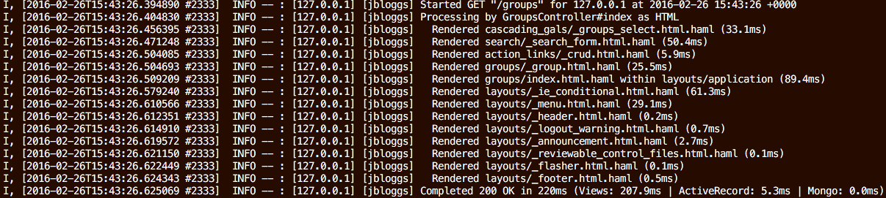
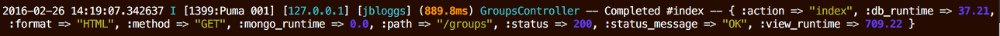
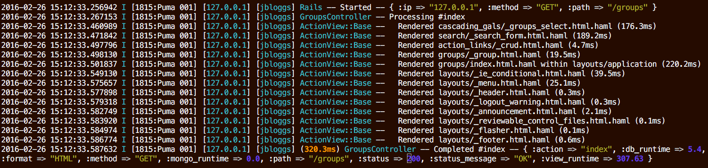
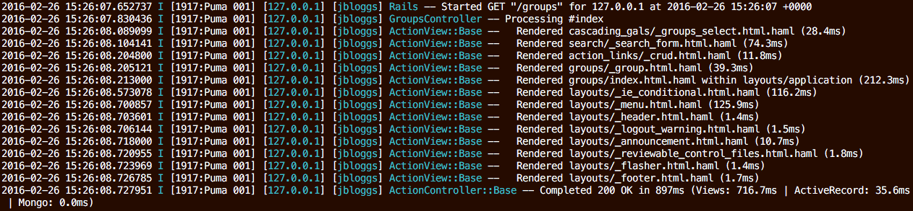
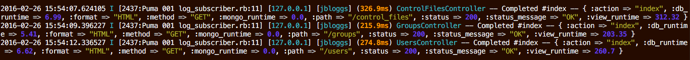

**Contents**

* TOC
{:toc}

[rails_semantic_logger](https://github.com/reidmorrison/rails_semantic_logger) is a companion gem
that wires Semantic Logger into Rails for you. Once installed it:

* Replaces the default Rails logger with Semantic Logger, so Rails, your application code, and many
  common gems all log through it.
* Collapses the several lines Rails normally logs per request into a single, structured "Completed"
  line, while keeping the individual fields (controller, action, status, durations, and so on)
  searchable.
* Lets you send logs anywhere Semantic Logger supports: the standard Rails log file, standard out as
  JSON for a container platform, a centralized log service, or several of these at once.

This page is a step-by-step guide that assumes no prior knowledge of either gem. Work through it
top to bottom: each section builds on the previous one. For the underlying logging API (logging
methods, tags, metrics, and so on) see the [Programmer's Guide](api.html), and for the full catalog
of log destinations see [Appenders](appenders.html).

> **Upgrading from v4?** The way appenders (log destinations) are configured changed in v5. Jump to
> [Migrating from v4 to v5](#migrating-from-v4-to-v5), then come back here.

### Requirements

Rails Semantic Logger v6 requires **Ruby 3.2 or later**, **Rails 7.2 or later**, and Semantic Logger v6. For the exact
list of tested Ruby and Rails versions, see the
[CI workflow](https://github.com/reidmorrison/rails_semantic_logger/blob/main/.github/workflows/ci.yml).

### Installation

Add the following lines to your `Gemfile`:

~~~ruby
gem "rails_semantic_logger"
gem "amazing_print" # optional
~~~

`amazing_print` is optional but recommended: it produces colorized, readable output of the
structured data (the Hash payload) in development.

Install with bundler:

    bundle install

That is all that is required. Rails Semantic Logger automatically replaces the standard Rails logger
with Semantic Logger and writes to the usual Rails log file.

#### Remove conflicting gems

Remove the following gems if present. They conflict with or duplicate what Rails Semantic Logger
already does:

* `lograge`
* `rails_stdout_logging`
* `rails_12factor`

### Out of the box

With no configuration at all, Rails Semantic Logger:

* Writes to `log/<environment>.log` (for example `log/development.log`), the same file Rails uses.
* Colorizes that output when Rails colorized logging is enabled (the default in development).
* Logs to **standard out** when you run `rails server`, so you see requests in your terminal.
* Logs to **standard error** when you run `rails console`, so log lines do not get mixed up with
  the return values of the commands you type.
* Replaces the multi-line Rails request log with a single structured "Completed" line.
* Redacts the keys in `config.filter_parameters`, such as `password` and `token`, from every log
  entry, not only from the request parameters. See [Redacting sensitive data](#redacting-sensitive-data).
* In development, records the file, line number, and method of the code behind each entry, such as
  `orders_controller.rb:12 OrdersController#create`. See
  [Source file name, line number, and method](#source-file-name-line-number-and-method).

Standard Rails log output for a single page request:

The same request after adding the `rails_semantic_logger` gem:

The rest of this page shows how to change **where** logs go and **how** they are formatted (the
appenders block), and then how to fine-tune **what** Rails logs.

Configuration goes in `config/application.rb` (for all environments) or in an environment file under
`config/environments/` (for one environment).

Use those two places, not `config/initializers/*`. Rails builds the logger **before** it loads
initializers, so the appenders block and the `semantic`, `replace_sidekiq_logger`, and
`replace_solid_queue_logger` options have no effect from an initializer; Rails Semantic Logger
prints a warning when it detects this. The output-tuning options consumed later in boot (`started`,
`processing`, `rendered`, `quiet_assets`, `action_message_format`, `redact_filter_parameters`) do
still work from an initializer, but not once the application has finished booting.

---

## Configuring where logs go: the appenders block

An **appender** is a destination for log output: a file, standard out, a centralized log service,
and so on. You declare the appenders you want inside a single block:

~~~ruby
config.rails_semantic_logger.appenders do |appenders|
  appenders.add(file_name: "log/#{Rails.env}.log", formatter: :color)
end
~~~

There are three ways to declare an appender. **The method name says _when_ the appender is created;
the arguments say _where_ it writes and _how_ it is formatted.**

| Method | Created when… | Default destination |
|--------|---------------|---------------------|
| `add` | Always, during Rails initialization | (you must specify one) |
| `add_server` | Only when serving requests: `rails server` (see the note under [Step 3](#step-3-log-to-the-screen-only-while-serving)) and Sidekiq in server mode | `$stdout` |
| `add_console` | Only inside a `rails console` session | `$stderr` |

The arguments to all three are exactly the arguments to `SemanticLogger.add_appender` (covered in
detail in [the next section](#appender-options-and-destinations)), so anything Semantic Logger can
log to, any of these can declare. One default of note: since `add_server` and `add_console` are
screen appenders, their `formatter:` defaults to `:color` when not specified; `add` uses the
Semantic Logger default of plain text.

> **Important:** As soon as you declare **any** appender in this block, Rails Semantic Logger stops
> adding **all** of its automatic appenders: the default `log/<env>.log` file, the standard-out
> logger it normally adds under `rails server`, and the standard-error logger it normally adds in
> `rails console`. The block becomes the single source of truth for every destination. So declare
> what you want: `add` for an always-on destination (such as the file log), `add_server` for screen
> output while serving, and `add_console` for the Rails console.

### Step 1: a single log file

~~~ruby
config.rails_semantic_logger.appenders do |appenders|
  appenders.add(file_name: "log/#{Rails.env}.log", formatter: :color)
end
~~~

### Step 2: add a JSON file for a log aggregator

Keep the human-readable color log and *also* write a JSON file for ingestion by Elasticsearch,
Splunk, Datadog, and the like:

~~~ruby
config.rails_semantic_logger.appenders do |appenders|
  appenders.add(file_name: "log/#{Rails.env}.log", formatter: :color)
  appenders.add(file_name: "log/#{Rails.env}.json", formatter: :json)
end
~~~

You can declare as many appenders as you like; every log entry is sent to all of them.

### Step 3: log to the screen only while serving

`add_server` declares an appender that is created **only** when the application is actually serving
requests (under `rails server` or Sidekiq in server mode), and never during rake tasks, runners, or
generators. It defaults to `$stdout`:

~~~ruby
config.rails_semantic_logger.appenders do |appenders|
  appenders.add(file_name: "log/#{Rails.env}.log", formatter: :json)
  appenders.add_server(formatter: :color) # → $stdout, only when serving
end
~~~

> **Note:** Under `rails server`, the appender is created when Rails itself would log to standard
> out: in development, when not daemonized. To get it in another environment, pass
> `--log-to-stdout` to `rails server`. App servers started directly (bare `puma`, `rackup`, and so
> on) need a one-line boot hook; see
> [Other app servers](#other-app-servers-puma-rackup-passenger-unicorn).

### Step 4: a dedicated console logger

`add_console` declares an appender created **only** inside a `rails console` session. It defaults to
`$stderr` so log output does not interleave with the results of the expressions you type:

~~~ruby
config.rails_semantic_logger.appenders do |appenders|
  appenders.add(file_name: "log/#{Rails.env}.log", formatter: :json)
  appenders.add_server(formatter: :color)  # $stdout while serving
  appenders.add_console(formatter: :color) # $stderr inside `rails console`
end
~~~

### Several appenders in one context

Because each call simply appends to its context, a context can have more than one appender. For
example, write a color stream *and* a JSON file, but only while serving:

~~~ruby
config.rails_semantic_logger.appenders do |appenders|
  appenders.add_server(io: $stdout, formatter: :color)
  appenders.add_server(file_name: "log/#{Rails.env}.log", formatter: :json)
end
~~~

---

## Appender options and destinations

Every `add`, `add_server`, and `add_console` call accepts the same arguments as
`SemanticLogger.add_appender`. This section is the one-stop reference for those arguments, written as
Rails examples. For the complete list of destinations and their service-specific options, see
[Appenders](appenders.html).

### Common options

In addition to a destination, most appenders accept these options:

| Option | Description |
|--------|-------------|
| `level` | Only write entries at this level or higher to this appender; for what it defaults to, and how it works with each logger's own level, which Rails Semantic Logger sets from `config.log_level`, see [Per-appender settings](config.html#per-appender-settings). |
| `formatter` | How to format the output: `:default`, `:color`, `:json`, `:logfmt`, `:one_line`, or a custom formatter (see [Output formats](#output-formats)). |
| `filter` | A `Regexp` or `Proc` selecting which entries this appender accepts. See [Filtering](config.html#filtering). |
| `application`, `environment`, `host` | Override the global values for this appender only. |

For example, send only warnings and above to a separate JSON file:

~~~ruby
config.rails_semantic_logger.appenders do |appenders|
  appenders.add(file_name: "log/#{Rails.env}.log", formatter: :color)
  appenders.add(file_name: "log/#{Rails.env}_errors.json", formatter: :json, level: :warn)
end
~~~

### Destinations

The destination is chosen by the argument you pass:

| Destination | Argument | Notes |
|-------------|----------|-------|
| Text or JSON file | `file_name:` | A path under `log/`. |
| IO stream | `io:` | `$stdout`, `$stderr`, or any `IO`. |
| Built-in appender | `appender: :name` | Selects a packaged appender by name (syslog, elasticsearch, http, bugsnag, and many more). |
| Existing Ruby/Rails logger | `logger:` | Wrap another logger instance. |
| Metrics destination | `metric:` | See [Metrics](metrics.html). |

A few common examples, all inside the appenders block:

~~~ruby
config.rails_semantic_logger.appenders do |appenders|
  # Local file
  appenders.add(file_name: "log/#{Rails.env}.log", formatter: :color)

  # Local Syslog
  appenders.add(appender: :syslog)

  # Remote syslog such as syslog-ng over TCP
  appenders.add(appender: :syslog, url: "tcp://myloghost:514")

  # Elasticsearch
  appenders.add(appender: :elasticsearch, url: "http://localhost:9200")

  # A generic HTTP(S) endpoint
  appenders.add(appender: :http, url: "https://logs.example.com/ingest")

  # Bugsnag (errors and above)
  appenders.add(appender: :bugsnag, level: :error)
end
~~~

Appenders for third-party services require their backing gem to be installed. See
[Appenders](appenders.html) for the full list of destinations, their gems, and their options.

### Output formats

The `formatter:` option controls how each appender renders a log entry. Because it is per appender,
you can write color to the screen and JSON to a file at the same time.

| Formatter | Output |
|-----------|--------|
| `:default` | Plain text, no color. |
| `:color` | Plain text with color (uses Amazing Print for the payload when installed). |
| `:json` | One JSON object per entry. |
| `:logfmt` | `key=value` logfmt output. |
| `:one_line` | Each entry reduced to a single line: line breaks are removed from every field (or escaped with `escape_control_chars: true`) and an exception shows only its class and message, without the backtrace. |
| A class instance | Any instance of a class derived from `SemanticLogger::Formatters::Base`. |
| A `Proc` | Called with the `log` entry; returns the formatted output. |

JSON example:

~~~ruby
config.rails_semantic_logger.appenders do |appenders|
  appenders.add(file_name: "log/#{Rails.env}.json", formatter: :json)
end
~~~

Custom formatter. Create `app/lib/my_formatter.rb`:

~~~ruby
# A custom colorized formatter
class MyFormatter < SemanticLogger::Formatters::Color
  # Return the complete log level name in uppercase
  def level
    "#{color}#{log.level.upcase}#{color_map.clear}"
  end
end
~~~

Then use it:

~~~ruby
config.rails_semantic_logger.appenders do |appenders|
  appenders.add(file_name: "log/#{Rails.env}.log", formatter: MyFormatter.new)
end
~~~

See [SemanticLogger::Formatters::Color](https://github.com/reidmorrison/semantic_logger/blob/main/lib/semantic_logger/formatters/color.rb)
for the methods you can override, and [Custom formatters](config.html#custom-formatters) for more on formatters.

#### Amazing Print options for the color formatter

The color formatter renders the payload Hash with Amazing Print. To pass options to it, give the
`:color` formatter a Hash:

~~~ruby
config.rails_semantic_logger.appenders do |appenders|
  appenders.add(
    file_name: "log/#{Rails.env}.log",
    formatter: {color: {ap: {multiline: false}}}
  )
end
~~~

See the [Amazing Print documentation](https://github.com/amazing-print/amazing_print) for the
available options (or set defaults in a `~/.aprc` file). This has no effect if Amazing Print is not
installed.

---

## Common recipes

### Development

Color to both the log file and the screen:

~~~ruby
# config/environments/development.rb
config.rails_semantic_logger.appenders do |appenders|
  appenders.add(file_name: "log/development.log", formatter: :color)
end
~~~

(The default already does this, so in development you often need no configuration at all.)

### Production on a container platform (Docker, Kubernetes, Heroku)

On a container platform the convention is to log JSON to standard out and let the platform collect
it. Use `add` (not `add_server`) so that rake tasks and one-off processes also log to stdout:

~~~ruby
# config/environments/production.rb
config.rails_semantic_logger.appenders do |appenders|
  appenders.add(io: $stdout, formatter: :json)
end
~~~

Because the block disables the automatic appenders, this JSON-to-stdout appender is the *only*
destination: there is no default file log and no separate color logger under `rails server`, which
is exactly what a container platform wants.

To keep one configuration that works both locally and in-cluster, gate the JSON appender on an
environment variable that is only set in the container platform. For example, in
`config/application.rb` (so it applies to every environment), switch to JSON on standard out only
when running inside Kubernetes:

~~~ruby
# config/application.rb
config.semantic_logger.application = "my_application"
config.semantic_logger.environment = ENV["STACK_NAME"] || Rails.env
config.log_level = ENV["LOG_LEVEL"] || :info

if ENV["LOG_TO_CONSOLE"] || ENV["KUBERNETES_SERVICE_HOST"]
  config.rails_semantic_logger.appenders do |appenders|
    appenders.add(io: $stdout, formatter: :json)
  end
end
~~~

Outside the cluster the block is skipped, so the default `log/<env>.log` file and the usual screen
loggers apply; inside the cluster JSON to stdout becomes the only destination.

On Heroku, also allow the log level to be set from the environment:

~~~ruby
config.log_level = ENV["LOG_LEVEL"].presence&.downcase&.to_sym || :info
~~~

`heroku config:set LOG_LEVEL=debug`

### Production writing to files plus an error service

~~~ruby
# config/environments/production.rb
config.rails_semantic_logger.appenders do |appenders|
  appenders.add(file_name: "log/production.json", formatter: :json)
  appenders.add(appender: :bugsnag, level: :error)
end
~~~

### Other app servers: puma, rackup, Passenger, Unicorn

`add_server` appenders are created automatically under `rails server` (following Rails' own
log-to-stdout rule: development and not daemonized, or the `--log-to-stdout` flag) and under Sidekiq
in server mode, because those have a definitive startup hook. App servers started **directly** (bare `puma`,
`rackup`, Passenger, Unicorn) have no such first-party hook, and Rails Semantic Logger deliberately
does **not** guess (a detection that only sometimes works is worse than none).

If you start your app with one of those servers and want your `add_server` appenders created, call
the helper from that server's own boot hook. For example, in `config/puma.rb`:

~~~ruby
on_booted { RailsSemanticLogger.add_server_appenders }
~~~

Alternatively, if you simply want a destination created in every context, declare it with `add`
instead of `add_server`.

### Sidekiq

Sidekiq in server mode is treated as a serving context, so `add_server` appenders are created
automatically. No extra configuration is required.

This wiring is part of the Sidekiq logger integration, so setting
`config.rails_semantic_logger.replace_sidekiq_logger = false` also turns off the automatic creation.
In that case, call `RailsSemanticLogger.add_server_appenders` yourself from a Sidekiq startup hook:

~~~ruby
# config/initializers/sidekiq.rb
Sidekiq.configure_server do |config|
  config.on(:startup) { RailsSemanticLogger.add_server_appenders }
end
~~~

---

## Tuning what Rails logs

The options below adjust Rails' own log output. They are independent of the appenders block and can
be combined with it.

### Log level

~~~ruby
# One of :trace, :debug, :info, :warn, :error, :fatal
config.log_level = :debug
~~~

To change the level inside a running `rails console`:

~~~ruby
SemanticLogger.default_level = :debug
~~~

### Re-enable Started, Processing, and Rendered messages

By default these messages are logged at `:debug` so they do not appear in production. To show them:

~~~ruby
config.rails_semantic_logger.started    = true # Rack "Started" line
config.rails_semantic_logger.processing = true # Controller "Processing" line
config.rails_semantic_logger.rendered   = true # Action View render lines
~~~

### Keep Rails' original wording

By default Action Controller and Active Record messages are converted to structured data:

~~~
Rack -- Started -- { :ip => "127.0.0.1", :method => "GET", :path => "/users" }
UserController -- Completed #index -- { :action => "index", :db_runtime => 54.64, :format => "HTML", :method => "GET", :path => "/users", :status => 200, :status_message => "OK", :view_runtime => 709.88 }
~~~

To keep Rails' original text messages (with Semantic Logger formatting) instead:

~~~ruby
config.rails_semantic_logger.semantic   = false
config.rails_semantic_logger.started    = true
config.rails_semantic_logger.processing = true
config.rails_semantic_logger.rendered   = true
~~~

### Quiet asset logging

Rails logs asset requests at the debug level, which can clutter development logs:

~~~
Rack -- Started -- {:ip => "127.0.0.1", :method => "GET", :path => "/assets/application.css"}
~~~

To silence them:

~~~ruby
config.rails_semantic_logger.quiet_assets = true
~~~

### Color output

Color is chosen per appender with the `formatter:` option: use `:color` for colorized output and
`:default` for plain text (see [Output formats](#output-formats)). For example, color on screen and
plain text in a file:

~~~ruby
config.rails_semantic_logger.appenders do |appenders|
  appenders.add(file_name: "log/#{Rails.env}.log", formatter: :default)
  appenders.add_server(formatter: :color)
end
~~~

The Rails `config.colorize_logging` setting does **not** affect appenders declared in the block; it
only influences the default file appender, which is created when the application declares no
appenders. Set it to `false` for a plain text `log/<environment>.log`.

### Named tags

Add tags to every log entry on a per-request basis by setting `config.log_tags` to a Hash:

~~~ruby
config.log_tags = {
  request_id: :request_id,
  ip:         :remote_ip,
  user:       ->(request) { request.cookie_jar["login"] }
}
~~~

Notes:

* If a value returns `nil`, that key is omitted for that request.
* To turn named tags off in development, set `config.log_tags = nil` in
  `config/environments/development.rb`.
* The tags are computed when the request enters the middleware stack, before the session is loaded
  and before authentication middleware such as Warden (used by Devise) runs. A value can come from
  the request's headers or cookies, but not from the signed-in user.

#### Tag a request with the signed-in user

To tag every entry logged while a controller handles a request with values that are only known
inside the controller, such as the signed-in user, wrap the action in an `around_action`:

~~~ruby
class ApplicationController < ActionController::Base
  around_action :tag_logs

  private

  def tag_logs(&)
    SemanticLogger.tagged({user_id: current_user&.id}.compact, &)
  end
end
~~~

The tags apply until the action finishes, and are removed even when it raises an exception. The
`compact` leaves the tag out for a request without a signed-in user. The tags are not on the
`Started`, `Processing`, and `Completed` entries, which are logged outside the action's callbacks. To
add the user to the `Completed` entry as well, see
[Add custom data to the Completed message](#add-custom-data-to-the-completed-message).

Use the block form, as above, rather than `SemanticLogger.push_named_tags` in a `before_action`.
Tags added with `push_tags` or `push_named_tags` stay on the thread until they are popped, and web
servers such as Puma serve many requests on each thread, so tags pushed during one request would be
logged for every later request on that thread.

When a nested block sets a named tag that is already set, its value replaces the earlier one. A
Hash value, such as `user: {id: 1}`, is replaced as a whole rather than merged with the earlier
Hash, so prefer flat keys such as `user_id:`.

### Source file name, line number, and method

In development, Rails Semantic Logger records the file, line number, and method of the code behind
each entry, at every level. In the Rails console it records them for each entry at the console's log
level, in every environment.

~~~
2026-11-15 13:58:05.906754 I [8462:puma srv tp 001 orders_controller.rb:12 OrdersController#create] OrdersController -- Creating order
~~~

To record them in another environment, or only at and above a level, set that level:

~~~ruby
config.semantic_logger.call_site_level = :info
~~~

To stop recording them in development, set it to `nil` in `config/application.rb`,
`config/environments/development.rb`, or an initializer:

~~~ruby
config.semantic_logger.call_site_level = nil
~~~

This reads only the stack frames up to the code that made the log call, so it is cheap enough to
leave on in production. See
[Recording where each entry was logged](config.html#recording-where-each-entry-was-logged) for its
cost, and for which formatters write it.

Rails logs the entries for its own events from Active Support's notifications, so the code that makes
their log call is Active Support's. Rails Semantic Logger records the application code behind each
one instead:

| Entry | Call site |
|-------|-----------|
| SQL query, strict loading violation | The code that ran the query |
| `Redirected to`, `Sent data`, `Sent file`, unpermitted parameters, fragment caching | The line in the action |
| `Processing`, `Completed`, CSRF warnings | The controller's action |
| `rescue_from` | Where the exception was raised |
| `Rendering`, `Rendered` | The code that called `render`, or the template that rendered a partial |
| Active Job | The code that enqueued or performed the job, or else the job's `#perform`, as for a job that a worker, or the inline or test adapter, performs from its queue |
| Action Mailer | The code that delivered the mail, or else the mailer's action |
| An exception that a request raised | Where your code raised it |

Entries with no application code behind them record no call site: `Started`, a halted filter chain,
a template that Rails renders once the action has returned, and the entries of Sidekiq's and Solid
Queue's own processes. Code that only wraps what Rails runs, such as an `around_action` or a
worker's middleware, is not taken for the code behind an entry that Rails logs once it has taken over
from your code, as it does to render an action's template, or to perform a job from its queue. The
application code is the first frame that the subscriber's `backtrace_cleaner` keeps,
`Rails.backtrace_cleaner` unless you assign another, such as
`RailsSemanticLogger::ActiveRecord::LogSubscriber.backtrace_cleaner`. It is also the `source` that
`config.active_record.verbose_query_logs` and `config.active_job.verbose_enqueue_logs` add to the
payload.

To capture the whole backtrace of each entry instead, use `backtrace_level`:

~~~ruby
config.semantic_logger.backtrace_level = :info
~~~

**Warning:** capturing a backtrace for every log entry allocates many objects. In production set this
to `nil` (disabled) or to a high level such as `:error`. By default backtraces are only captured for
`:error` and `:fatal`. This feature is best used in development.

### Cleaning exception backtraces

Rails Semantic Logger cleans the backtraces of logged exceptions with `Rails.backtrace_cleaner`, as
Rails' own log does: only your application's frames are logged, relative to `Rails.root`. The
silencers and filters added in `config/initializers/backtrace_silencers.rb` apply, since they change
the same cleaner. Set the `BACKTRACE` environment variable to log full backtraces again, as with the
rest of Rails.

The text and JSON formatters use it, including the JSON sent by the HTTP, Elasticsearch HTTP, TCP,
UDP, Kafka, RabbitMQ, and CloudWatch Logs appenders. Error services, such as Sentry, still receive
the full backtrace. When none of an exception's frames is your application's, such as one raised
entirely within a gem, the full backtrace is logged.

A request for a missing route, and the other exceptions that Rails logs without a backtrace when
none of its frames is your application's (those in `ActionDispatch::ExceptionWrapper.silent_exceptions`),
is logged on one line, after the response's status, as in Rails' own log:

~~~
Rails -- 404 Not Found -- Exception: ActionController::RoutingError: No route matches [GET] "/apple-touch-icon.png"
~~~

That entry has the exception's class and message, and names the exceptions that caused it, which
Rails lists as "Caused by", but not the exception itself (`log_exception: :partial`): the `:json`
formatter writes them in its `message`, and Semantic Logger's own error service appenders, such as
`sentry_ruby`, receive a message rather than an exception. Error services hooked into Rails still receive the exception. Set `BACKTRACE` to log
these with their backtrace, or set `config.action_dispatch.log_rescued_responses = false` to leave
them out of the log.

To use another cleaner, or none, assign it in `config/application.rb`. This does not change how the
exceptions above are logged:

~~~ruby
config.semantic_logger.backtrace_cleaner = nil
~~~

See [Cleaning backtraces](config.html#cleaning-backtraces) for which formatters use it, and how to
choose for one appender.

### Redacting sensitive data

Rails filters `config.filter_parameters` only from the request parameters that it logs. Rails Semantic
Logger also has Semantic Logger redact them from every log entry: the value of each key that they
match is written as `"[FILTERED]"`, at any depth, in the payload, named tags, and context, by every
appender. That covers your own calls, such as `logger.info("Charged", card: card_params)`, and the
entries of other gems, as well as Rails' own. The filters are read once the application has
initialized, so those in `config/initializers/filter_parameter_logging.rb` apply.

Keys are matched by name, both as written and in snake_case, so `:_key` also matches an `X-Api-Key`
header, as `x_api_key`. A filter matches any key that contains it, so the default list of a new Rails
application (`:passw, :email, :secret, :token, :_key, :crypt, :salt, :certificate, :otp, :ssn, :cvv,
:cvc`) also redacts keys that are not secret, such as `max_tokens`, `token_count`, `cache_key`, and
`api_key_id`, the `concurrency_key` of Solid Queue's entries, and every `email`.

That list does not match the `Authorization` or `Cookie` header. Add them:

~~~ruby
# config/initializers/filter_parameter_logging.rb
Rails.application.config.filter_parameters += %i[authorization cookie]
~~~

What is not redacted:

* Active Job `arguments` and Action Mailer `args`, which are logged as JSON text. For a job that takes
  a secret, leave its arguments out of the log with `self.log_arguments = false`.
* A key that only a Proc filter matches: a Proc changes a value rather than naming a key, so it is
  left out.
* A key nested under the one a dotted filter names. A filter such as `"credit_card.code"` only
  matches a key with that whole name, not `code` inside `credit_card`. That includes the
  `"model.attribute"` filters that Rails adds for Active Record encrypted attributes.
* The message, plain tags, and exception messages: only keyed data is redacted.
* Entries logged while the application starts, before the list is complete.

To use other keys instead, assign them in `config/application.rb`, and Rails Semantic Logger keeps
them:

~~~ruby
config.semantic_logger.sensitive_keys = %i[passw secret token _key authorization cookie]
~~~

To turn redaction off:

~~~ruby
config.rails_semantic_logger.redact_filter_parameters = false
~~~

Assigning `config.semantic_logger.sensitive_keys = nil` does not turn it off, since that cannot be
told apart from never assigning it. See [Redacting sensitive data](security.html#redacting-sensitive-data)
for what `sensitive_keys` accepts, and when redaction runs.

### Add custom data to the Completed message

Add an `append_info_to_payload` method to a controller to include extra fields in its Completed
message:

~~~ruby
class ThingController < ApplicationController
  private

  def append_info_to_payload(payload)
    super
    payload[:user_id] = current_user&.id
  end
end
~~~

### Customize the Completed message text

Provide a Proc to build the Action Controller message from the message and payload:

~~~ruby
config.rails_semantic_logger.action_message_format = ->(message, payload) do
  "#{message} - #{payload[:controller]}##{payload[:action]}"
end
~~~

### Background job loggers

By default Rails Semantic Logger replaces the Sidekiq and SolidQueue loggers. To leave them alone:

~~~ruby
config.rails_semantic_logger.replace_sidekiq_logger     = false
config.rails_semantic_logger.replace_solid_queue_logger = false
~~~

Sidekiq v7 and v8 are supported. Earlier Sidekiq versions were supported up to
Rails Semantic Logger v5.0.

#### Sidekiq job lifecycle messages

For every Sidekiq job, Rails Semantic Logger emits a `Start #perform` and a `Completed #perform`
entry. On very high job volumes these can add noise and cost in log aggregation tools. To turn them
off (the job still runs, any exceptions are still logged, and its
[metrics](#sidekiq-metrics) are still recorded):

~~~ruby
# config/initializers/sidekiq.rb
RailsSemanticLogger::Sidekiq::JobLogger.perform_messages = false
~~~

This defaults to `true`, so the messages are emitted unless you opt out. It turns off only the log
entries: the job's metrics do not depend on it.

On Sidekiq 8, the standard Sidekiq setting has the same effect and is also honored:

~~~ruby
Sidekiq.configure_server do |config|
  config[:skip_default_job_logging] = true
end
~~~

#### Sidekiq metrics

Once a [metric appender](metrics.html) is added, each Sidekiq job records two histograms, in
seconds, named after the OpenTelemetry conventions:

| Metric | What it measures | Dimensions |
|--------|------------------|------------|
| `sidekiq.queue.duration` | How long the job waited in its queue, from when it was enqueued until it started. No OpenTelemetry convention covers it, so it is named after Sidekiq. | `messaging.system.name` (`sidekiq`), `messaging.destination.name` (the queue) |
| `messaging.process.duration` | How long the job ran. | The same, plus `messaging.operation.name` (`process`), `messaging.sidekiq.job.class`, and `error.type`, the exception class, when the job raised |

A job enqueued by a host whose clock is ahead records a queue duration of zero, and a job without an
`enqueued_at` records none. `config.rails_semantic_logger.metrics = false` turns them off, with the
other [Rails metrics](#metrics).

#### Sidekiq job logging context

Every log entry emitted while a job runs is tagged with the job's `jid`, class, and queue, plus its
`bid` (batch id) and `tags` when present. On Sidekiq 8, the standard `logged_job_attributes` setting
is honored, so additional job attributes can be added to the logging context:

~~~ruby
Sidekiq.configure_server do |config|
  config[:logged_job_attributes] = %w[bid tags priority]
end
~~~

#### Testing Sidekiq jobs and middleware

Use the [test helpers](testing.html) (`capture_semantic_logger_events` in RSpec,
`semantic_logger_events` in Minitest) to capture the log events from jobs and server middleware. This
relies on `replace_sidekiq_logger` being on (the default): with it off, jobs and middleware log
through a plain `Sidekiq::Logger`, which the helpers do not capture.

Two things differ from a running Sidekiq server:

- Sidekiq's testing modes (`inline!`, and `fake!` with `drain` or `perform_one`) run only the
  middleware added to `Sidekiq::Testing.server_middleware`, not the chain from
  `Sidekiq.configure_server`. Add the middleware under test there.
- The job logger does not run, so there are no `Start #perform` or `Completed #perform` entries, and
  no `jid`, class, or queue named tags. Named tags added by your own middleware are still present.

Capture every event rather than one class's. Middleware that includes `Sidekiq::ServerMiddleware`
logs through Sidekiq's configured logger, which a capture scoped to a class, such as
`capture_semantic_logger_events(Sidekiq)`, does not reach.

The example below turns on Sidekiq's testing modes with `Sidekiq.testing!(:fake)`, available from
Sidekiq 8.1.1. On earlier versions use `require "sidekiq/testing"` instead.

~~~ruby
# spec/rails_helper.rb
Sidekiq.testing!(:fake)

# app/sidekiq/tenant_logging_middleware.rb
class TenantLoggingMiddleware
  include Sidekiq::ServerMiddleware

  def call(_job_instance, job, _queue, &block)
    SemanticLogger.tagged(tenant: job["tenant"], &block)
  end
end

# app/sidekiq/report_job.rb
class ReportJob
  include Sidekiq::Job

  def perform
    logger.info("Building report")
  end
end

# spec/sidekiq/tenant_logging_middleware_spec.rb
RSpec.describe TenantLoggingMiddleware do
  around { |example| Sidekiq::Testing.inline! { example.run } }
  before { Sidekiq::Testing.server_middleware { |chain| chain.add TenantLoggingMiddleware } }
  after  { Sidekiq::Testing.server_middleware { |chain| chain.remove TenantLoggingMiddleware } }

  it "tags the job's log entries with the tenant" do
    events = capture_semantic_logger_events { ReportJob.set(tenant: "acme").perform_async }
    event  = events.find { |e| e.name == "ReportJob" }

    expect(event).to be_a_semantic_logger_event(message: "Building report")
    expect(event.named_tags).to include(tenant: "acme")
  end
end
~~~

The last line checks only the `tenant` tag, so the test still passes when other named tags are
active.

### Custom controller base class

If your application uses a controller base class other than `ActionController::Base` or
`ActionController::API`, Rails Semantic Logger falls back to the `ActionController::Base` logger, so
those entries are named `ActionController::Base`. To give them the correct class name, include the
mixin in your base class:

~~~ruby
include SemanticLogger::Loggable
~~~

If the base class lives in a third-party gem, do it from an initializer:

~~~ruby
CustomControllerBase.include(SemanticLogger::Loggable)
~~~

---

## Metrics

Rails Semantic Logger records metrics for requests, database queries, jobs, views, mailers, and the
cache, whatever is logged. They are named after the
[OpenTelemetry semantic conventions](https://opentelemetry.io/docs/specs/semconv/) where one
exists, so dashboards built for those conventions work unchanged, and under the system that owns
the event otherwise. Each histogram is in seconds.

Nothing is sent until a [metric appender](metrics.html) is added, such as OTLP to a local
OpenTelemetry Collector; until then a metric costs about 40 ns:

~~~ruby
config.rails_semantic_logger.appenders do |appenders|
  appenders.add(file_name: "log/#{Rails.env}.log")
  appenders.add(metric: :otlp)
end
~~~

To record none of them, Sidekiq's included, set this in `config/application.rb` or
`config/environments/*.rb`:

~~~ruby
config.rails_semantic_logger.metrics = false
~~~

| Metric | Kind | What it measures | Dimensions |
|--------|------|------------------|------------|
| `http.server.request.duration` | histogram | Each request, from the first middleware until its body is closed | `http.request.method`, `url.scheme`, `http.route` (`/articles/:id`), `http.response.status_code`, `error.type` |
| `rails.action_controller.process_action.duration` | histogram | The controller action, without the middleware | `code.function.name` (`ArticlesController#show`), `http.response.status_code`, `error.type` |
| `rails.action_controller.redirects` | counter | Redirects | `code.function.name`, `http.response.status_code` |
| `rails.action_controller.halted_callbacks` | counter | Filter chains halted by a callback | `rails.action_controller.filter` |
| `rails.action_controller.rescued_exceptions` | counter | Exceptions handled by `rescue_from` (Rails 8.1+) | `error.type` |
| `rails.action_controller.unsafe_redirects` | counter | Open and path relative redirects reported with `:notify` (Rails 8.1+) | `rails.action_controller.redirect.kind` |
| `rails.action_controller.csrf_events` | counter | CSRF checks that failed or fell back (Rails 8.2+) | `rails.action_controller.csrf.reason` |
| `rails.action_controller.send_file.duration`, `send_data.duration`, `fragment_cache.duration` | histogram | Sending files and data, and fragment caching | `rails.cache.operation.name` (fragment cache) |
| `rails.action_view.render.duration` | histogram | Each template, partial, layout, and collection rendered | `rails.action_view.render.kind`, `rails.action_view.template` (`articles/show.html.erb`) |
| `db.client.operation.duration` | histogram | Each query sent to the database (not cached, schema, or explain queries) | `db.system.name`, `db.namespace`, `db.operation.name`, `error.type` |
| `messaging.client.sent.messages` | counter | Jobs enqueued | `messaging.system.name` (`active_job`), `messaging.destination.name` (the queue), `messaging.active_job.job.class` |
| `messaging.client.operation.duration` | histogram | Enqueuing, one job or several | `messaging.operation.name` (`enqueue`, `enqueue_at`, `enqueue_all`), the adapter, `error.type` |
| `messaging.process.duration` | histogram | Each job performed | `messaging.system.name` (`active_job` or `sidekiq`), the queue, the job class, `error.type` |
| `active_job.queue.duration` | histogram | How long a job waited in its queue from when it was due | The queue, the job class |
| `active_job.retries`, `exhausted_retries`, `discards`, `interrupts`, `resumes` | counter | Retries, given-up retries, discards, and continuation interrupts and resumes | The queue, the job class, `error.type` |
| `active_job.step.duration` | histogram | Each continuation step (Rails 8.1+) | `active_job.step.name`, `active_job.step.interrupted`, `error.type` |
| `rails.action_mailer.delivery.duration`, `process.duration` | histogram | Delivering and building a mail | `rails.action_mailer.mailer` or `code.function.name`, `error.type` |
| `rails.cache.operation.duration` | histogram | Each cache operation | `rails.cache.operation.name`, `rails.cache.store`, `rails.cache.hit` |
| `solid_queue.operation.duration` | histogram | Each Solid Queue operation | `solid_queue.operation.name`, `error.type` |

Sidekiq's own metrics are described in [Sidekiq metrics](#sidekiq-metrics). A job that Active Job
runs on Sidekiq is recorded by both, under `messaging.system.name` `active_job` and `sidekiq`: sum
one system or the other, never both.

`error.type` is set only when the operation failed: the exception's class, or for a request the
status code of a 5xx response. Every dimension has a small, fixed set of values, so no id, path, or
SQL text becomes a series.

---

## Operational notes

### Process forking

If you use a forking server (Puma, Unicorn) or fork worker processes, see
[Process Forking](operations.html#process-forking). With Semantic Logger v5 appenders are reopened automatically after
a fork, so the manual `after_fork { SemanticLogger.reopen }` hook is usually no longer needed.

### Drop messages instead of blocking

By default, if log messages arrive faster than the appenders can write them, calls to `logger.info`
wait once the in-memory queue is full, so requests, jobs, and shutdown hooks that log can stall behind
a slow destination. When staying responsive matters more than keeping every message, have them dropped
instead, in `config/application.rb` or `config/environments/production.rb`:

~~~ruby
config.semantic_logger.non_blocking = true
~~~

This needs Semantic Logger v5.2 or later. See
[Drop messages instead of blocking](operations.html#drop-messages-instead-of-blocking) for how it
relates to the per-appender `non_blocking:` option and how dropped messages are reported.

### Log rotation

Because the log file is held open between writes, rotate it with a **copy-truncate** strategy rather
than deleting and recreating the file. Example `logrotate` configuration for Linux:

~~~
/var/www/my_app/shared/log/*.log {
  daily
  missingok
  copytruncate
  rotate 14
  compress
  delaycompress
  notifempty
}
~~~

### Loggers that are replaced automatically

Rails Semantic Logger gives Rails and its components a Semantic Logger logger each: `Rails.logger`,
and the loggers of Active Record, Action Controller, Action View, Action Mailer, Active Job, and
Active Support's cache store, each named after its component, such as `ActiveRecord::Base`. After
they initialize, it also replaces the loggers of these libraries when present:

- Action Cable
- Bugsnag
- Delayed Job
- IOStreams
- Mongo
- Mongoid
- Moped
- Resque
- Sidekiq (unless `replace_sidekiq_logger = false`)
- Sidetiq
- Solid Queue (unless `replace_solid_queue_logger = false`)

Each of these loggers is the one through which its component or library logs. The
[metrics](#metrics) of Active Record, Action Controller, Action View, Action Mailer, Active Job, the
cache store, Sidekiq, and Solid Queue are recorded through it too. Action Controller logs each
controller's entries through that controller's own logger, named after it, such as
`ArticlesController`, and only its metrics through `ActionController::Base`'s.

Do not replace one of these loggers yourself, with a Ruby `Logger`, another logger that is not a
Semantic Logger one, or `nil`, such as with `config.solid_queue.logger = Logger.new($stdout)`: that
is not supported, and can break its log entries and its metrics.

To log less from a component or library, set the level of its logger instead, such as in
`config/initializers/logging.rb`:

~~~ruby
# No SQL queries, which are logged at :debug. Set as Active Record loads, rather than loading it early.
ActiveSupport.on_load(:active_record) { logger.level = :info }

SolidQueue.logger.level = :warn
~~~

For a controller, set the level of its own logger, in the controller:

~~~ruby
class ArticlesController < ApplicationController
  logger.level = :warn
end
~~~

A logger's level applies to its log entries only: its metrics are recorded whatever it logs. To
record no Rails metrics, set `config.rails_semantic_logger.metrics = false`.

---

## Upgrading to v6

v6 requires Semantic Logger v6; see [Upgrading to Semantic Logger v6](upgrading.html#upgrading-to-semantic-logger-v6)
for the changes there. For a Rails application the largest change is the metrics: renamed after the
OpenTelemetry conventions, and recorded apart from the logs.

### The deprecated appender options are removed

`config.rails_semantic_logger.format`, `ap_options`, `filter`, `console_logger`, and
`add_file_appender` have warned since v5 and are gone: setting one raises `NoMethodError`. Declare
the destinations in the [appenders block](#configuring-where-logs-go-the-appenders-block) instead:

| Removed option | Instead |
|----------------|---------|
| `config.rails_semantic_logger.format = :json` | `appenders.add(file_name: "log/#{Rails.env}.log", formatter: :json)` |
| `config.rails_semantic_logger.ap_options = {multiline: true}` | `formatter: {color: {ap: {multiline: true}}}` on the appender |
| `config.rails_semantic_logger.filter = /MyClass/` | `filter: /MyClass/` on the appender |
| `config.rails_semantic_logger.console_logger = false` | Declare your appenders, without an `add_console` one |
| `config.rails_semantic_logger.add_file_appender = false` | Declare your appenders: declaring any replaces the default file appender |

Without an appenders block nothing changes: Rails Semantic Logger writes `log/<environment>.log` in
color (plain text when `config.colorize_logging` is `false`), and to the screen under `rails server`,
Sidekiq, and `rails console`.

If you set `add_file_appender = false` or `console_logger = false`, do not just delete the line:
that brings back `log/<environment>.log`, or the screen output, which `console_logger` also turned off
under `rails server` and Sidekiq. Move every appender into the appenders block instead, including
those added with `config.semantic_logger.add_appender`. Declaring any appender there turns off the
default file appender and the default screen appenders:

~~~ruby
# v5
config.rails_semantic_logger.add_file_appender = false
config.rails_semantic_logger.console_logger    = false
config.semantic_logger.add_appender(io: $stdout, formatter: :json)

# v6
config.rails_semantic_logger.appenders do |appenders|
  appenders.add(io: $stdout, formatter: :json)
end
~~~

The default file appender no longer changes the formatter of the file and IO appenders that an
application adds itself with `config.semantic_logger.add_appender`: each keeps the formatter it was
given.

`Rails.application.deprecators[:rails_semantic_logger]` is still registered, so configuration that
silences it keeps working.

### The metrics are renamed, and recorded apart from the logs

The metrics take OpenTelemetry names where a convention exists, gain dimensions, and are recorded
whatever is logged, so the log entries no longer carry a `metric`. Update any dashboard or alert
that reads the old names; see [Metrics](#metrics) for the new ones:

| v5 | v6 |
|----|----|
| `rails.controller.process_action` | `http.server.request.duration` for the whole request, and `rails.action_controller.process_action.duration` for the action |
| `rails.controller.redirect_to`, `halted_callback`, `rescue_from_callback`, `open_redirect`, `unsafe_redirect`, `csrf_*` | `rails.action_controller.redirects`, `halted_callbacks`, `rescued_exceptions`, `unsafe_redirects`, `csrf_events` |
| `rails.controller.send_file`, `send_data`, and the fragment cache events | `rails.action_controller.send_file.duration`, `send_data.duration`, `fragment_cache.duration` |
| `rails.view.render.template`, `partial`, `layout`, `collection` | `rails.action_view.render.duration`, by `rails.action_view.render.kind` |
| none | `db.client.operation.duration` and `rails.cache.operation.duration` |
| `rails.job.enqueue`, `enqueue_at`, `enqueue_all` | `messaging.client.sent.messages` and `messaging.client.operation.duration` |
| `rails.job.perform`, `perform_start` | `messaging.process.duration` and `active_job.queue.duration` |
| `rails.job.enqueue_retry`, `retry_stopped`, `discard`, `interrupt`, `resume`, `step` | `active_job.retries`, `exhausted_retries`, `discards`, `interrupts`, `resumes`, `step.duration` |
| `rails.mailer.deliver` | `rails.action_mailer.delivery.duration` |
| `rails.solid_queue.<event>` | `solid_queue.operation.duration`, by `solid_queue.operation.name` |
| `sidekiq.queue.latency`, the `metric_amount` of the `Start #perform` entry, in milliseconds | `sidekiq.queue.duration`, a histogram in seconds |
| `sidekiq.job.perform`, the `duration` of the `Completed #perform` entry | `messaging.process.duration`, a histogram in seconds |

v5 recorded a metric only with an entry logged at `:info` or above, so it recorded no render metric
by default; v6 records every render, query, and job. Turning off the Sidekiq perform messages with
`perform_messages = false` or `skip_default_job_logging` no longer turns off its metrics; set
`config.rails_semantic_logger.metrics = false` for that.

### `add_server` and `add_console` give only a stream or a file the color formatter

A metric appender, which refuses a formatter in Semantic Logger v6, an appender instance, a logger
(`logger:`), and an appender named by a Symbol (such as `appender: :syslog`) keep their own default
formatter, so the last two no longer write colored text.

---

## Upgrading to v5.3

v5.3 requires Semantic Logger v5.3; see [Upgrading to Semantic Logger v5.3](upgrading.html#upgrading-to-semantic-logger-v53)
for the changes there. It needs no configuration changes, but several log entries change. Review
these before you upgrade if a log query, dashboard, or alert depends on them.

### Exception backtraces are cleaned

The backtraces of logged exceptions are now cleaned with `Rails.backtrace_cleaner`, as in Rails' own
log: only your application's frames are written, relative to `Rails.root`. Error services, such as
Sentry, still receive the full backtrace. To log full backtraces again, set the `BACKTRACE`
environment variable, or turn cleaning off in `config/application.rb`:

~~~ruby
config.semantic_logger.backtrace_cleaner = nil
~~~

A request for a missing route, and the other exceptions in
`ActionDispatch::ExceptionWrapper.silent_exceptions`, is now logged on one line, without the exception
itself, when none of its frames is your application's. Semantic Logger's own error service appenders,
such as `sentry_ruby`, therefore receive a message for it rather than an exception. See
[Cleaning exception backtraces](#cleaning-exception-backtraces).

### `config.filter_parameters` are redacted from every entry

The keys in `config.filter_parameters` are now redacted from the payload, named tags, and context of
every log entry, not only from the request parameters. A filter matches any key that contains it, so
Rails' default filters also redact keys such as `email`, `max_tokens`, `cache_key`, and
`api_key_id`. Rails' defaults do not match the `Authorization` or `Cookie` headers, so consider adding
them. To turn redaction off:

~~~ruby
config.rails_semantic_logger.redact_filter_parameters = false
~~~

See [Redacting sensitive data](#redacting-sensitive-data).

### Call sites are recorded in development

In development, each entry now records the file, line, and method of the code behind it. The text
formatters write it after the thread name, and the `:json` formatter as `file`, `line`, and `method`.
In the Rails console it replaces capturing a backtrace for every entry. To turn it off:

~~~ruby
config.semantic_logger.call_site_level = nil
~~~

See [Source file name, line number, and method](#source-file-name-line-number-and-method).

### Other log output changes

* Active Record: SQL bind values that have no column name are keyed by position (`$1`, `$2`, ...),
  as in Rails 8.2's own log, instead of all under a `nil` key. Update anything that matches
  `payload.binds.nil`.
* Active Job: the message of an enqueue that failed now closes its parentheses:
  `Failed enqueuing MyJob (Job ID: 1a2b) to Sidekiq(default): RuntimeError (boom)`.
* Action Controller: the `source` of a `Redirected to` entry, written when
  `ActionDispatch.verbose_redirect_logs` is on, is now relative to `Rails.root` instead of an absolute
  path.
* `config.active_record.verbose_query_logs` and `config.active_job.verbose_enqueue_logs`, which new
  Rails applications turn on in development, are now honored: query and enqueue entries gain a
  `source` in their payload.
* Rails 8.1+: open redirects and path relative redirects reported with `:notify` are now logged at
  `:warn`. On Rails 8.2, CSRF failures are logged at `:warn` again.

See the [CHANGELOG](https://github.com/reidmorrison/rails_semantic_logger/blob/main/CHANGELOG.md)
for the full list, including Rails 8.2 support.

---

## Upgrading to v5.1

v5.1 requires Semantic Logger v5.1 and needs no configuration changes. Two behaviors differ.

### A log file that cannot be opened now fails at boot

Semantic Logger v5.1 opens the file appender's log file when the appender is created, rather than on
the first write. A missing directory, a bad path, or insufficient permissions therefore raises
during boot, where Rails Semantic Logger catches it and falls back to logging to standard error at
the `:warn` level, with a message explaining the problem.

Previously that failure surfaced asynchronously on the appender thread after the application had
already booted, so the fallback never ran and the app kept running against an appender that silently
dropped every message. If you have been running with an unwritable log path without noticing, this
release is when you will find out.

As a side effect, the log file is created as soon as the appender is added, even if nothing has been
logged yet. This matches the standard Ruby and Rails loggers.

### Sidekiq v4, v5, and v6 are no longer supported

Sidekiq v7 and v8 are supported and tested. The patches for older versions have been removed, along
with the pre-7.1.6 error handler branches. Sidekiq v7 and v8 both predate this gem's Rails 7.2 and
Ruby 3.2 minimums, so upgrading Sidekiq is the path forward.

On Sidekiq 8 two of its own settings are now honored: `logged_job_attributes` adds job attributes to
the logging context, and `skip_default_job_logging` suppresses the `Start #perform` /
`Completed #perform` messages (an alternative to
`RailsSemanticLogger::Sidekiq::JobLogger.perform_messages = false`). See
[Sidekiq](#sidekiq) for the logging configuration.

---

## Migrating from v4 to v5

### Ruby and Rails minimums

v5 requires Ruby 3.2+ and Rails 7.2+. It also depends on Semantic Logger v5; review the
[Semantic Logger upgrade notes](upgrading.html) for changes there (the most relevant for Rails apps
is that appenders are now reopened automatically after fork, so you can remove manual reopen hooks).

### Appender configuration is the main change

In v4 the log file, its format, and any extra destinations were configured through several separate
options (`format`, `add_file_appender`, `ap_options`, `filter`, `console_logger`) plus direct
`config.semantic_logger.add_appender(...)` calls. In v5 all of that lives in one place, the
[appenders block](#configuring-where-logs-go-the-appenders-block).

These v4 options still work in v5 but emit a deprecation warning, and were **removed in v6**.
Migrate them as follows:

| v4 | v5 |
|----|----|
| `config.rails_semantic_logger.format = :json` | `appenders.add(file_name: "log/#{Rails.env}.log", formatter: :json)` |
| `config.rails_semantic_logger.add_file_appender = false` then `config.semantic_logger.add_appender(...)` | Declare your destinations with `appenders.add(...)` (declaring any appender already replaces the default file appender) |
| `config.rails_semantic_logger.ap_options = {multiline: false}` | `appenders.add(..., formatter: {color: {ap: {multiline: false}}})` |
| `config.rails_semantic_logger.filter = /MyClass/` | `appenders.add(..., filter: /MyClass/)` |
| `config.rails_semantic_logger.console_logger = false` | Omit `add_console` (declare a console appender only if you want one) |

A v4 Heroku / standard-out configuration like:

~~~ruby
# v4
if ENV["RAILS_LOG_TO_STDOUT"].present?
  $stdout.sync = true
  config.rails_semantic_logger.add_file_appender = false
  config.semantic_logger.add_appender(io: $stdout, formatter: config.rails_semantic_logger.format)
end
~~~

becomes, in v5:

~~~ruby
# v5
config.rails_semantic_logger.appenders do |appenders|
  appenders.add(io: $stdout, formatter: :json)
end
~~~

### Server standard-out behavior

In v4, running `rails server` always added a standard-out logger, which you suppressed with
`bin/rails s --daemon` or Puma's `--quiet`. In v5 this is the job of `add_server`: when you use the
appenders block, declare an `add_server` appender to log to the screen while serving, or omit it to
stay silent. If you do not use the appenders block at all, the v4 behavior is preserved.

---

## Migrating from earlier versions

These notes apply to upgrades between older releases and are retained for reference.

### v4.16: Sidekiq metrics support

Rails Semantic Logger added support for Sidekiq metrics, available when the JSON logging format is
used:

* `sidekiq.job.perform` &mdash; the duration of each Sidekiq job; `duration` contains the time in
  milliseconds that the job took to run.
* `sidekiq.queue.latency` &mdash; the time between when a Sidekiq job was enqueued and when it was
  started; `metric_amount` contains the time in milliseconds that the job was waiting in the queue.

### v4.15 and v4.16: Sidekiq support

Rails Semantic Logger introduced direct support for Sidekiq v4, v5, v6, and v7. Remove any previous
custom patches or configurations used to make Sidekiq work with Semantic Logger. To see the complete
list of patches and to contribute your own, see
[Sidekiq Patches](https://github.com/reidmorrison/rails_semantic_logger/blob/v5.0.0/lib/rails_semantic_logger/extensions/sidekiq/sidekiq.rb).
Support for Sidekiq v4, v5, and v6 ended after Rails Semantic Logger v5.0; Sidekiq v7 and v8 are
supported and tested.

### v4.4

With some forking frameworks it was necessary to call `reopen` after the fork. As of v4.4 the
workaround for Ruby 2.5 crashes is no longer needed. Remove the following line if it is called
anywhere:

~~~ruby
SemanticLogger::Processor.instance.instance_variable_set(:@queue, Queue.new)
~~~
